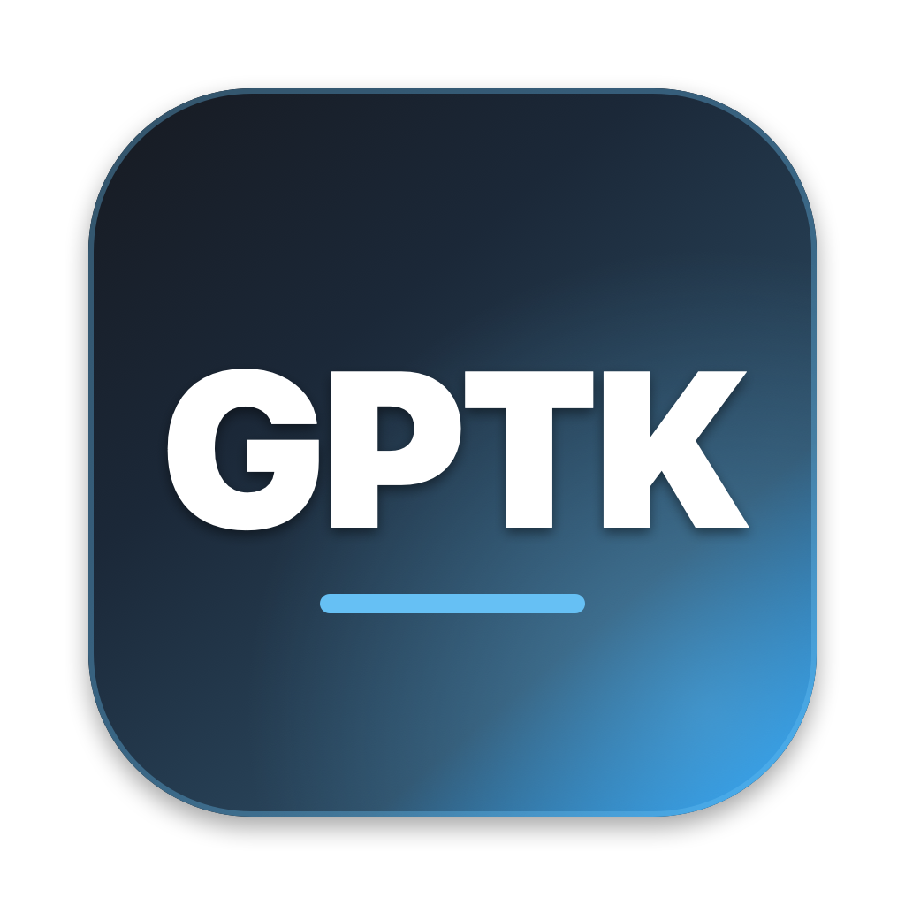

<p align="center"></p>

# GPTK for Steam

Adds Apple's **Game Porting Toolkit (GPTK) 3 and 4** to the Mac Steam client's compatibility menu, so Windows games install and run from Steam itself.

<p align="center"><a href="../../releases/download/v0.5/GPTK-for-Steam.zip"><b>⬇ Download GPTK for Steam v0.5 (experimental)</b></a></p>

After setup, every game's **Properties ▸ Compatibility** menu offers:

| Option | What it does |
|---|---|
| **GPTK 4.0 beta 3** | Runs the Windows version with GPTK 4 (DirectX 11/12 → Metal, MetalFX for DLSS). The default for Windows-only games. |
| **GPTK 3.0** | Runs the Windows version with GPTK 3. |
| **No Compatibility Tool** | Runs the Mac version. The default for games that have one. |

## Install

1. [Download `GPTK-for-Steam.zip`](../../releases/download/v0.5/GPTK-for-Steam.zip) (also on the [Releases](../../releases) page under **Assets**) and unzip it.
2. Open **GPTK for Steam**. The first time, macOS may block it because it isn't notarized: open **System Settings ▸ Privacy & Security** and click **Open Anyway**.
3. Click **Set Up**. You'll be asked how to turn on Steam Play:
   - **Make a second Steam (recommended):** creates *Steam (GPTK)* in Applications and leaves your Steam unmodified.
   - **Modify my installed Steam:** turns on Steam Play in your existing Steam.
4. Quit Steam (⌘Q), open it again, and install a Windows game.

The first setup downloads Wine 7.7 for GPTK 3 (about 240 MB) from [Gcenx's free build](https://github.com/Gcenx/game-porting-toolkit).

**Requirements:** an Apple Silicon Mac, macOS 14 or later, and Steam.

## Repair

Each time it opens, the app checks the setup. If something is missing or broken (for example after a Steam update, or if Steam (GPTK) was deleted), it shows **Issue detected** and a **Repair** button that rebuilds what's needed: Steam itself, Steam (GPTK), Steam Play, the GPTK tools, their Wine and the files games need to see Steam.

## Limits

- Games with kernel-level anti-cheat don't run. VAC games run without online matchmaking.
- Steam Play is turned on by modifying a copy of Steam with [NotProton](https://github.com/NotProtonNot/NotProton)'s enabler. A Steam update can switch it off; Repair turns it back on.
- Modifying the Steam client is against Valve's terms in principle. Use at your own risk.

## How it works

- Each GPTK version is a Steam compatibility tool in `~/Library/Application Support/Steam/compatibilitytools.d`.
- GPTK 3 runs on Wine 7.7; GPTK 4 needs a GPTK-patched Wine 11. Each tool clones its Wine and lays Apple's GPTK files on top (APFS clones, so this costs almost no disk space).
- GPTK 4 runs games through Valve's Steam bridge (`lsteamclient`), so `steam_api`, Steam DRM and Steam Cloud work. The Windows profile is `steamuser` inside `compatdata/<game>/pfx`, where Steam Cloud puts saves.
- GPTK 4 takes over NotProton's default tool slot, which is what Windows-only games get unless you pick something else.

## Building from source

```sh
./build.sh
```

`build.sh` expects a `Payload/` folder, which isn't in this repository because of its size:

| Folder | Contents |
|---|---|
| `Payload/gptk/<version>/` | `external/` and `wine/` from Apple's *Evaluation environment for Windows games* (`redist/lib`), plus `Payload/gptk/LICENSES/<version>/` |
| `Payload/wine-11-gptk/` | A GPTK-patched Wine 11 (`bin`, `lib`, `share`) |
| `Payload/notproton/` | NotProton's `notproton.dylib`, its `support/` files and the open-source bridge parts |

`Resources/run` is the launch script each tool uses. `make-icon.swift` draws the app icon.

## Third-party software

The app download bundles software by others under their own licenses. See [THIRD-PARTY-NOTICES.md](THIRD-PARTY-NOTICES.md).

Not affiliated with Apple, Valve, CodeWeavers or the NotProton project. Steam is a trademark of Valve Corporation.

## License

The code in this repository is under the [MIT License](LICENSE).
